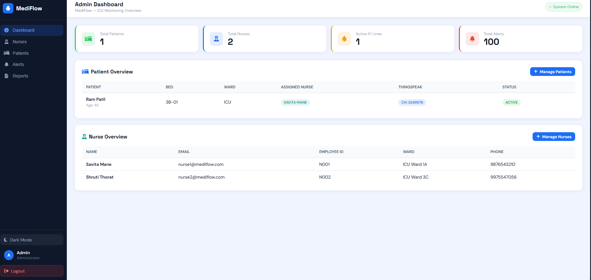
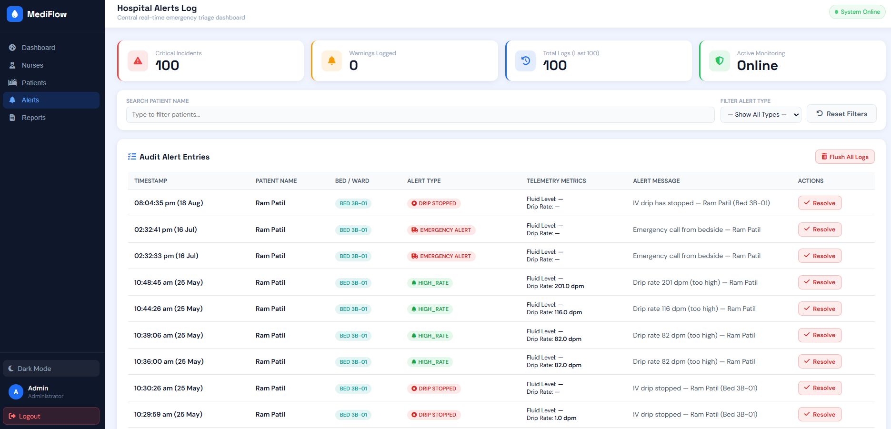
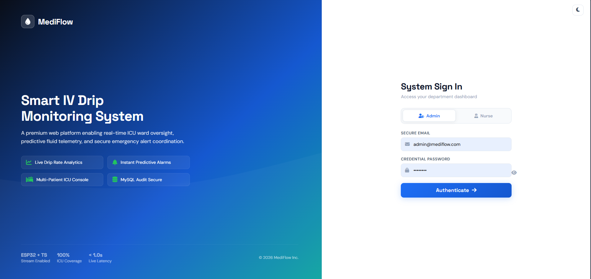
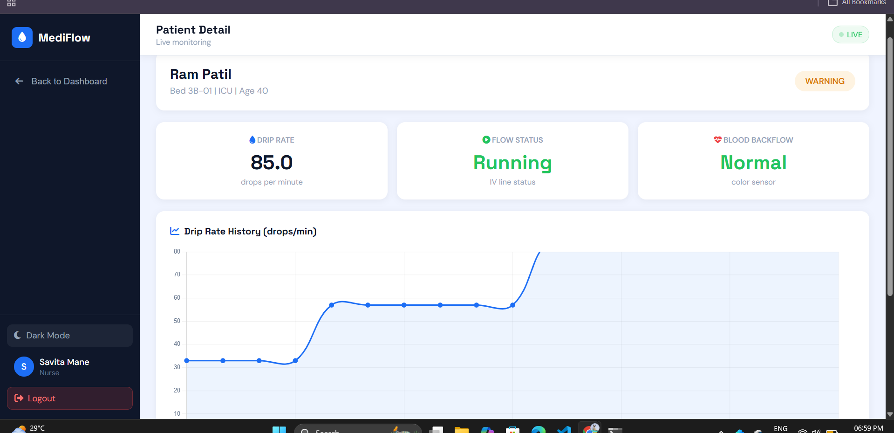
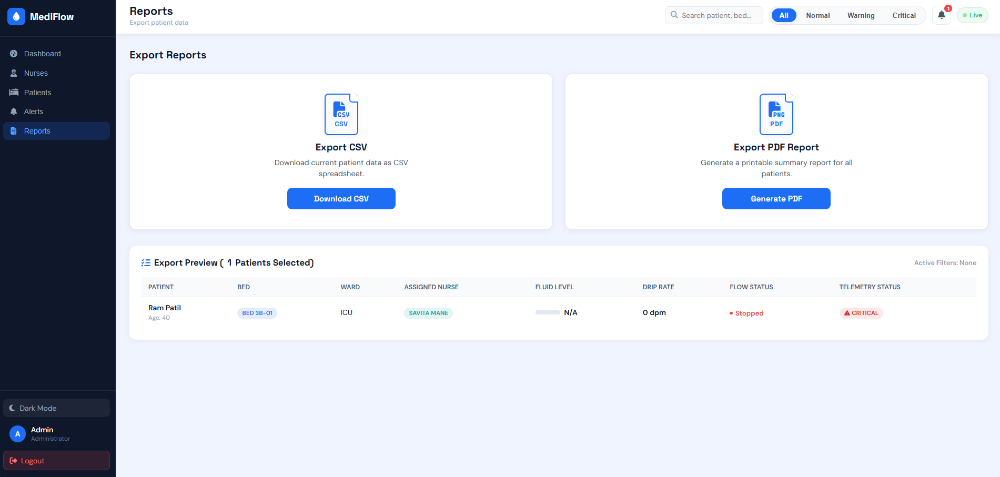

# MediFlow — Smart IV Drip & Real-Time ICU Telemetry System

> A comprehensive, real-time IV drip monitoring and emergency triage platform for hospital ICUs. Integrates ESP32 hardware sensors via ThingSpeak, provides nurse and admin monitoring dashboards, and supports automated emergency alerts and PDF/CSV report exports.

---

## 📌 Project Overview

**MediFlow** is designed to solve critical challenges in hospital fluid administration. By continuously measuring drop counts and detecting flow interruptions or blood backflow in real-time, MediFlow helps healthcare professionals deliver safer patient care and respond immediately to critical ICU emergencies.

This repository contains the complete **Phase 3 Full-Stack Application** featuring a Node.js/Express REST backend, MySQL database storage, ThingSpeak IoT sensor integration, and a responsive frontend web UI.

---

## ✨ Key Features

- 🛡️ **Role-Based Access Control**: Separate secure portals for **Administrators** and **Nurses** authenticated via JSON Web Tokens (JWT) and bcrypt password hashing.
- 💧 **Real-Time Telemetry Tracking**: Integrates with ESP32 IR drip sensors and TCS34725 color sensors via ThingSpeak APIs to monitor drip rates and blood backflow.
- 🚨 **Emergency Triage & Alarms**: Visual flash indicators, acoustic beep alarms, and instant notifications for:
  - 🚫 **Drip Stopped** (0 dpm / line obstruction)
  - 🩸 **Blood Backflow** (detected via color sensor)
  - ⚡ **High Drip Rate** (>65 dpm)
  - 🚨 **Bedside Emergency Calls**
- 📊 **Interactive Analytics**: Historical telemetry visualization using **Chart.js** line charts with real-time graph updates.
- 📄 **ICU Audit & Export Reports**:
  - Download patient telemetry data as `.csv` spreadsheets.
  - Generate printable PDF summary audit reports with single-click browser printing.
- 👥 **Nurse & Patient Management**: Admin panel for adding/editing patients, configuring ThingSpeak channel credentials, and assigning nurses to specific beds/wards.

---

## 🖼️ Application Screenshots

| Admin Dashboard | Hospital Alerts Log |
| :---: | :---: |
|  |  |

| Nurse Patient Monitoring | Patient Detail & Live Chart |
| :---: | :---: |
|  |  |

| Export Reports (CSV & PDF) |
| :---: |
|  |

> 💡 *To add your own screenshots, save your image files inside the `screenshots/` directory with the names listed above.*

---

## 🛠️ Tech Stack & Architecture

- **Frontend**: HTML5, CSS3, JavaScript (ES6+ Async/Await), [Chart.js](https://www.chartjs.org/), FontAwesome 6
- **Backend**: [Node.js](https://nodejs.org/), [Express.js](https://expressjs.js.org/)
- **Database**: [MySQL](https://www.mysql.com/) (`mysql2` connection pool with Promise support)
- **Authentication**: JSON Web Tokens (`jsonwebtoken`) & `bcryptjs`
- **IoT / Telemetry**: ThingSpeak REST API Integration (ESP32 IR & TCS34725 sensors)

---

## 📂 Project Structure

```text
mediflow/
├── frontend/
│   ├── admin/              # Administrator portal pages
│   │   ├── alerts.html     # Real-time alert log & audit entries
│   │   ├── dashboard.html  # System overview & stats summary
│   │   ├── nurses.html     # Nurse account management (CRUD)
│   │   ├── patients.html   # Patient & ThingSpeak channel management
│   │   └── reports.html    # Export preview, CSV download & PDF printing
│   ├── nurse/              # Nurse portal pages
│   │   ├── dashboard.html  # Live monitoring grid for assigned patients
│   │   └── patient.html    # Single patient live detail & telemetry graph
│   ├── css/                # Styling and main layout stylesheet
│   ├── js/                 # Shared JS modules (api.js, auth.js, alerts.js, thingspeak.js)
│   └── index.html          # Unified login portal (Admin / Nurse)
├── server/
│   ├── middleware/         # Auth token & role verification middleware
│   ├── routes/             # REST API routes (auth, nurses, patients, alerts, readings)
│   ├── .env                # Database credentials & JWT secret (ignored in git)
│   ├── db.js               # MySQL pool connection
│   ├── server.js           # Express application entry point
│   └── package.json        # Backend Node.js dependencies
├── screenshots/            # UI screenshot images for documentation
├── .gitignore              # Git ignore configuration
└── README.md               # Project documentation
```

---

## 🗄️ Database Schema Setup

Create a MySQL database named `mediflow` and run the following table structure:

```sql
CREATE DATABASE IF NOT EXISTS mediflow;
USE mediflow;

-- 1. Users Table (Admin & Nurses login)
CREATE TABLE IF NOT EXISTS users (
  id INT AUTO_INCREMENT PRIMARY KEY,
  name VARCHAR(100) NOT NULL,
  email VARCHAR(150) UNIQUE NOT NULL,
  password VARCHAR(255) NOT NULL,
  role ENUM('admin', 'nurse') NOT NULL DEFAULT 'nurse',
  created_at TIMESTAMP DEFAULT CURRENT_TIMESTAMP
);

-- 2. Nurses Profile Table
CREATE TABLE IF NOT EXISTS nurses (
  id INT AUTO_INCREMENT PRIMARY KEY,
  user_id INT NOT NULL,
  employee_id VARCHAR(50),
  phone VARCHAR(20),
  ward VARCHAR(50),
  FOREIGN KEY (user_id) REFERENCES users(id) ON DELETE CASCADE
);

-- 3. Patients Table
CREATE TABLE IF NOT EXISTS patients (
  id INT AUTO_INCREMENT PRIMARY KEY,
  name VARCHAR(100) NOT NULL,
  age INT,
  bed_number VARCHAR(20) NOT NULL,
  ward VARCHAR(50),
  diagnosis TEXT,
  thingspeak_channel_id VARCHAR(50),
  thingspeak_read_key VARCHAR(50),
  assigned_nurse_id INT,
  is_active BOOLEAN DEFAULT TRUE,
  admitted_at TIMESTAMP DEFAULT CURRENT_TIMESTAMP,
  FOREIGN KEY (assigned_nurse_id) REFERENCES nurses(id) ON DELETE SET NULL
);

-- 4. Alerts Log Table
CREATE TABLE IF NOT EXISTS alerts_log (
  id INT AUTO_INCREMENT PRIMARY KEY,
  patient_id INT NOT NULL,
  alert_type ENUM('drip_stopped', 'backflow', 'high_rate', 'emergency') NOT NULL,
  message VARCHAR(255) NOT NULL,
  drip_rate FLOAT,
  created_at TIMESTAMP DEFAULT CURRENT_TIMESTAMP,
  FOREIGN KEY (patient_id) REFERENCES patients(id) ON DELETE CASCADE
);

-- 5. Sensor Readings History Table
CREATE TABLE IF NOT EXISTS readings (
  id INT AUTO_INCREMENT PRIMARY KEY,
  patient_id INT NOT NULL,
  drip_rate FLOAT DEFAULT 0,
  flow_status VARCHAR(20) DEFAULT 'Stopped',
  blood_detected BOOLEAN DEFAULT FALSE,
  recorded_at TIMESTAMP DEFAULT CURRENT_TIMESTAMP,
  FOREIGN KEY (patient_id) REFERENCES patients(id) ON DELETE CASCADE
);
```

---

## ⚡ Quick Start & Setup Guide

### 1. Prerequisites
- [Node.js](https://nodejs.org/) (v16 or higher)
- [MySQL Server](https://dev.mysql.com/downloads/mysql/) (v8.0 or XAMPP / WAMP)

### 2. Configure Environment Variables
Navigate to the `server/` directory and create/verify your `.env` file:

```env
PORT=3000
DB_HOST=localhost
DB_USER=root
DB_PASSWORD=your_mysql_password
DB_NAME=mediflow
JWT_SECRET=mediflow_super_secret_jwt_key_2026
```

### 3. Install Dependencies & Start Backend
Open VS Code Terminal in the `server` directory and run:

```bash
cd server
npm install
node server.js
```

### 4. Open in Browser
Open your browser and visit:
```text
http://localhost:3000
```

---

## 📝 License & Credits

Developed as part of the **Smart IV Drip & Telemetry Monitoring System** project.
- **Repository**: [https://github.com/Ragini-telange/-Minor_project_SmartIVDripMonitoring.git](https://github.com/Ragini-telange/-Minor_project_SmartIVDripMonitoring.git)
- **Author**: Ragini Telange
